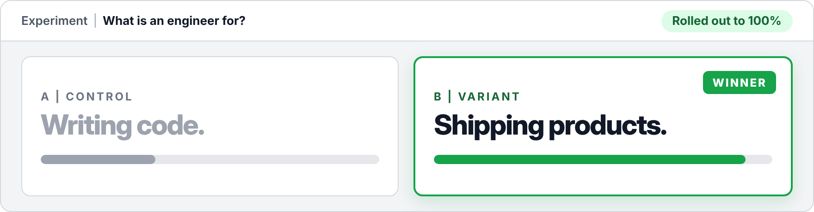
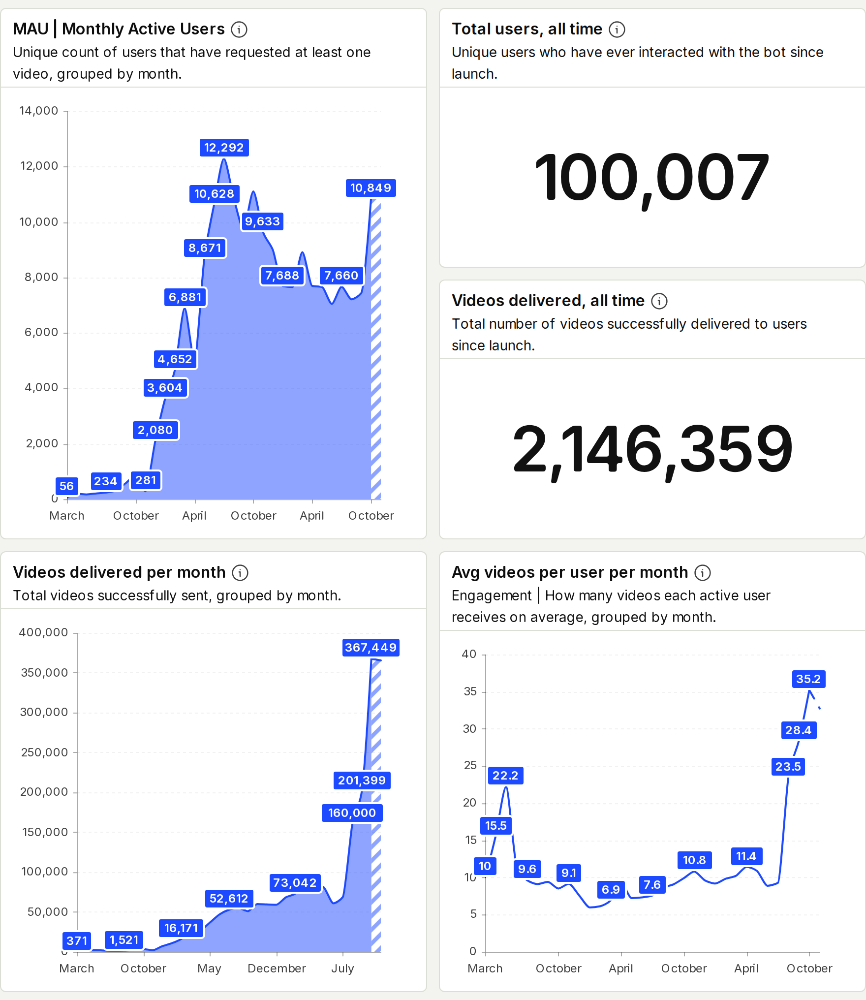

### Hey, I'm Javier

I'm a Product Engineer from Madrid with 12+ years of experience. I have been part of several startups and scale-ups always focusing on having an impact on the product and the business and using the code as a means to an end. AI has forced all engineers to be like this but I have been doing it since I started.

I enjoy focusing on solving the user needs, interviewing them, running experiments and non-stop shipping. I'm currently a Staff Product Engineer at [Smallpdf](https://smallpdf.com/), working on Monetization & Payments, and before that I was part of [Playtomic](https://playtomic.com/) where I had the chance to build a product end-to-end that allowed Club Managers to run tournaments more effectively.

Here you can see a snippet of things that I also like to do in my free time. You can find all of them listed at [javiercorisco.com](https://javiercorisco.com), a website that is also my tribute to how the webpages looked when I started creating them with CMS like PHP-Nuke, don't worry about my taste because it is on purpose. Some of my side projects include:

* [Wit](https://javiercorisco.com/projects/wit-telegram-bots): Started as a script I wrote in an afternoon almost 3 years ago (before LLMs were a thing) that allowed me to send a Twitter link to a Telegram bot and the bot would return the raw video so I could share it in my group chats, mostly for memes. It has grown to a single Cloudflare Worker running three different branded bots that has delivered over 2 million videos to more than 100,000 users since I launched. All the growth is absolutely organic. The image of the dashboard below comes straight from PostHog and refreshes every week!

  

* [Dashboards for PostHog](https://javiercorisco.com/projects/trmnl-posthog): a TRMNL plugin that mirrors a PostHog dashboard on an e-ink display. The TRMNL team selected it as a Featured Plugin and wrote about it on their blog.
* [TwitchFollowingOrganizer](https://javiercorisco.com/projects/twitch-following-organizer): a Chrome extension that sorts the Twitch channels you follow into folders, right inside Twitch's own sidebar. Started it before AI and just recently revamped it because it was abandoned. It is currently live on the [Chrome Web Store](https://chromewebstore.google.com/detail/twitchfollowingorganizer/nbkhejjefhgndeobikkemkmkdoiefeop).
* [...and many more on my website](https://javiercorisco.com/projects)

The best way to reach me is [LinkedIn](https://www.linkedin.com/in/jruizcorisco/). Feel free to reach out.
